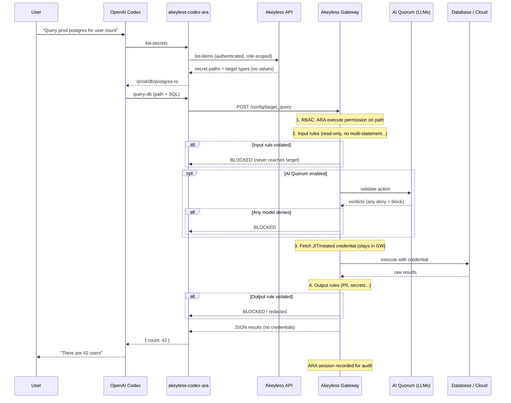

# Akeyless Plugin for OpenAI Codex

OpenAI Codex plugin that connects the Akeyless Model Context Protocol (MCP) server to Codex, without installing or configuring the Akeyless CLI. AI agents can query databases, run actions on AWS, Azure, GCP, Kubernetes and GitHub, and execute commands on Linux (SSH), Windows (WinRM) and LDAP / Active Directory servers through [Akeyless Agentic Runtime Authority (ARA)](https://docs.akeyless.io/docs/agentic-runtime-authority).

Codex orchestrates. Akeyless holds the credentials. **Secret values never enter the model context.**

## Install

```bash
npm install -g @akeyless-community/codex-mcp
```

Or run without installing:

```bash
npx -y @akeyless-community/codex-mcp
```

## Quick start

### 1. Configure auth

Set credentials in the MCP server process environment (not in Codex prompts):

```bash
export AKEYLESS_ACCESS_ID="p-xxxxx"
export AKEYLESS_ACCESS_KEY="your-access-key"
export AKEYLESS_GATEWAY_URL="https://your-gateway.example.com:8000"
export AKEYLESS_AGENT_ID="codex-agent"
```

`AKEYLESS_GATEWAY_URL` is the only gateway setting required. The SDK API base (`/api/v2`) and ARA execution base are derived automatically — same pattern as the [Claude connector](https://github.com/akeyless-community/claude-akeyless-connector).

See [`.env.example`](.env.example) for JWT, Universal Identity, cloud IAM, and token auth.

### 2. Connect Codex

Add to `~/.codex/config.toml`:

```toml
[mcp_servers.akeyless-ara]
command = "npx"
args = ["-y", "@akeyless-community/codex-mcp"]
enabled = true
default_tools_approval_mode = "prompt"
startup_timeout_sec = 20
tool_timeout_sec = 120

[mcp_servers.akeyless-ara.env]
AKEYLESS_ACCESS_ID = "p-xxxxx"
AKEYLESS_ACCESS_KEY = "your-access-key"
AKEYLESS_GATEWAY_URL = "https://your-gateway.example.com:8000"
AKEYLESS_AGENT_ID = "codex-agent"

[mcp_servers.akeyless-ara.tools.query-db]
approval_mode = "prompt"

[mcp_servers.akeyless-ara.tools.service-execute]
approval_mode = "prompt"

[mcp_servers.akeyless-ara.tools.list-secrets]
approval_mode = "auto"
```

Or use the CLI:

```bash
codex mcp add akeyless-ara \
  --env AKEYLESS_ACCESS_ID=p-xxxxx \
  --env AKEYLESS_ACCESS_KEY=your-key \
  --env AKEYLESS_GATEWAY_URL=https://your-gateway.example.com:8000 \
  -- npx -y @akeyless-community/codex-mcp
```

Project-scoped config: copy [`examples/.codex/config.toml`](examples/.codex/config.toml).

### 3. Ask Codex

> "List my Akeyless ARA secrets."

> "Run `SELECT count(*) FROM users` against `/prod/db/postgres-readonly`."

> "Use service-execute on `/prod/aws/devops` to list S3 buckets."

## MCP tools (ARA only)

| Tool | Purpose |
|---|---|
| `list-secrets` | List dynamic, rotated, and custom-MCP secrets with `ara_allow_access` |
| `query-db` | Run database queries (MySQL, PostgreSQL, MSSQL, Oracle, Snowflake, etc.) |
| `service-execute` | Run AWS, GCP, Azure, Kubernetes, GitHub, or custom-MCP actions |
| `list-sub-tools` | (Optional) Discover sub-tools on a service secret before `service-execute` |

## Architecture




## Requirements

- [Akeyless Gateway](https://docs.akeyless.io/docs/about-akeyless-gateway) with Runtime Authority and AI Insights configured
- ARA role rules with **Allow Access** on secret paths
- Dynamic secrets with **Agentic Runtime Authority** enabled in the Console

When `list-secrets` returns zero results, check the `diagnostics.troubleshooting` hints in the response.

## Install as a Codex plugin

```bash
codex plugin marketplace add akeyless-community/codex-akeyless-mcp
```

Then in Codex: `/plugins` → **Akeyless Community** → install **Akeyless ARA**.

See [Marketplace guide](docs/MARKETPLACE.md).

## Security model

- **Secretless by design** — list tools return metadata only; execute tools use credentials server-side via the Gateway
- **Codex approval** — set `prompt` or `approve` for `query-db` and `service-execute`
- **Least privilege** — scope RBAC to ARA-enabled secret paths only
- **Single gateway URL** — point `AKEYLESS_GATEWAY_URL` at your organization's gateway

See [SECURITY.md](SECURITY.md).

## Development

```bash
cd codex-akeyless-integration
npm install
npm test
npm run build
npm start
```

## Related projects

- [claude-akeyless-connector](https://github.com/akeyless-community/claude-akeyless-connector) — same ARA surface for Claude Desktop
- [Akeyless ARA docs](https://docs.akeyless.io/docs/agentic-runtime-authority)

## License

Apache-2.0
