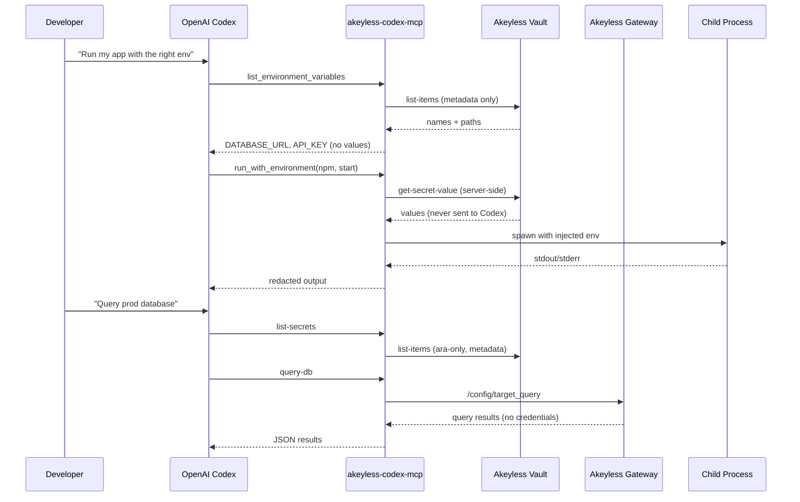

# Akeyless Trusted Access Layer for OpenAI Codex

An MCP server that makes [Akeyless](https://www.akeyless.io) the **trusted access layer** for [OpenAI Codex](https://developers.openai.com/codex/).

Codex orchestrates. Akeyless holds the secrets. **Secret values never enter the model context.**

## Why this exists

Coding agents like Codex need credentials to run apps, call APIs, and deploy code. Today those credentials often live in `.env` files, shell history, or hardcoded in repos — easy to exfiltrate and hard to audit.

This integration gives Codex secure, auditable access without putting secrets in prompts or code:

| Capability | What Codex sees | What actually happens |
|---|---|---|
| List environment | Variable **names** + Akeyless paths | No values fetched |
| Run with environment | Command stdout/stderr (redacted) | Secrets injected into child process env |
| ARA query / execute | Query or action results only | Credentials used server-side via Gateway |
| Store secret | Path + env var name | Value written to Akeyless only |
| Scan for secrets | File + line + redacted snippet | Full values never returned |

## Architecture



## Quick start

### 1. Install

```bash
npm install -g @akeyless-community/codex-mcp
```

Or run without installing:

```bash
npx -y @akeyless-community/codex-mcp
```

### 2. Configure Akeyless auth

Set credentials for the MCP server process (not in Codex prompts):

```bash
export AKEYLESS_ACCESS_ID="p-xxxxx"
export AKEYLESS_ACCESS_KEY="your-access-key"
export AKEYLESS_ENVIRONMENT_PREFIX="/codex/my-app/local"
export AKEYLESS_GATEWAY_URL="https://api.akeyless.io"

# Required for ARA tools (query-db, service-execute):
export AKEYLESS_ARA_GATEWAY_URL="https://your-gateway.example.com:8000"
export AKEYLESS_AGENT_ID="codex-agent"
```

See [`.env.example`](.env.example) for all auth options.

### 3. Connect Codex

Add to `~/.codex/config.toml`:

```toml
[mcp_servers.akeyless]
command = "npx"
args = ["-y", "@akeyless-community/codex-mcp"]
enabled = true
default_tools_approval_mode = "prompt"
startup_timeout_sec = 20
tool_timeout_sec = 120

[mcp_servers.akeyless.env]
AKEYLESS_ACCESS_ID = "p-xxxxx"
AKEYLESS_ACCESS_KEY = "your-access-key"
AKEYLESS_ENVIRONMENT_PREFIX = "/codex/my-app/local"
AKEYLESS_GATEWAY_URL = "https://api.akeyless.io"
AKEYLESS_ARA_GATEWAY_URL = "https://your-gateway.example.com:8000"
AKEYLESS_AGENT_ID = "codex-agent"

[mcp_servers.akeyless.tools.store_secret]
approval_mode = "approve"

[mcp_servers.akeyless.tools.run_with_environment]
approval_mode = "prompt"

[mcp_servers.akeyless.tools.query-db]
approval_mode = "prompt"

[mcp_servers.akeyless.tools.service-execute]
approval_mode = "prompt"
```

Or use the CLI:

```bash
codex mcp add akeyless \
  --env AKEYLESS_ACCESS_ID=p-xxxxx \
  --env AKEYLESS_ACCESS_KEY=your-key \
  --env AKEYLESS_ENVIRONMENT_PREFIX=/codex/my-app/local \
  --env AKEYLESS_ARA_GATEWAY_URL=https://your-gateway.example.com:8000 \
  -- npx -y @akeyless-community/codex-mcp
```

For project-scoped config, copy [`examples/.codex/config.toml`](examples/.codex/config.toml) into your repo (requires a trusted project).

### 4. Organize secrets in Akeyless

Static env vars for app bootstrap:

```
/codex/my-app/local/DATABASE_URL
/codex/my-app/local/STRIPE_SECRET_KEY
/codex/my-app/local/OPENAI_API_KEY
```

Dynamic secrets for Runtime Authority (ARA):

```
/prod/dynamic-secrets/postgres-readonly
/prod/dynamic-secrets/aws-devops
```

### 5. Ask Codex

> "List my environment variables and run `npm test` with secrets from Akeyless."

> "List ARA secrets and run `SELECT count(*) FROM users` against the postgres dynamic secret."

> "Scan this repo for hardcoded secrets and migrate them to Akeyless."

## MCP tools

### Environment tools

| Tool | Purpose |
|---|---|
| `list_environment_variables` | List env var names under an Akeyless prefix |
| `describe_environment` | Summary of the active environment |
| `create_environment` | Bootstrap a new `/codex/{project}/{stage}` prefix |
| `store_secret` | Migrate a secret into Akeyless (approval recommended) |
| `run_with_environment` | Run a command with JIT secret injection |
| `write_env_reference` | Generate `.env.example` with `akeyless://` references |
| `scan_for_exposed_secrets` | Find hardcoded credentials in the repo |

### Runtime Authority (ARA) tools

| Tool | Purpose |
|---|---|
| `list-secrets` | List dynamic/rotated secrets available for secretless access |
| `query-db` | Run database queries (MySQL, PostgreSQL, MSSQL, Oracle, Snowflake, etc.) |
| `service-execute` | Run AWS, GCP, Azure, Kubernetes, or GitHub actions |

ARA execute tools require an [Akeyless Gateway](https://docs.akeyless.io/docs/about-akeyless-gateway) with Runtime Authority enabled. Set `AKEYLESS_ARA_GATEWAY_URL` to your gateway configuration port (e.g. `http://127.0.0.1:8000`).

## Security model

**Secretless by design:**
- Read tools return metadata only
- `run_with_environment` redacts injected values from stdout/stderr
- ARA tools use credentials server-side — only action results are returned
- `scan_for_exposed_secrets` returns redacted snippets only

**Requires Codex approval:**
- `store_secret` — value transits MCP once during migration
- `run_with_environment` — spawns commands with real credentials
- `query-db` / `service-execute` — executes against live infrastructure

**Recommendations:**
- Set `default_tools_approval_mode = "prompt"` in Codex config
- Scope RBAC in Akeyless to `/codex/*` for env tools and ARA paths for execute tools
- Prefer dynamic secrets and ARA for databases and cloud APIs
- Never commit `.env` files — use `write_env_reference` instead

## Development

```bash
cd codex-akeyless-integration
npm install
npm run build
npm test
```

Run locally:

```bash
AKEYLESS_ACCESS_ID=... AKEYLESS_ACCESS_KEY=... npm start
```

## Publishing

See [docs/PUBLISHING.md](docs/PUBLISHING.md) for npm release instructions.

## Related projects

- [`@akeyless-community/vercel-runtime`](../vercel-akeyless-runtime) — runtime secret fetch on Vercel
- [`akeyless mcp-runtime-authority`](../akeyless-main-repo/go/src/client/commands/mcp_runtime_authority.go) — CLI ARA MCP server
- [`bedrock-agentcore-akeyless-runtime`](../bedrock-agentcore-akeyless-runtime) — AWS AgentCore integration

## License

Apache-2.0 — see [LICENSE](LICENSE).
